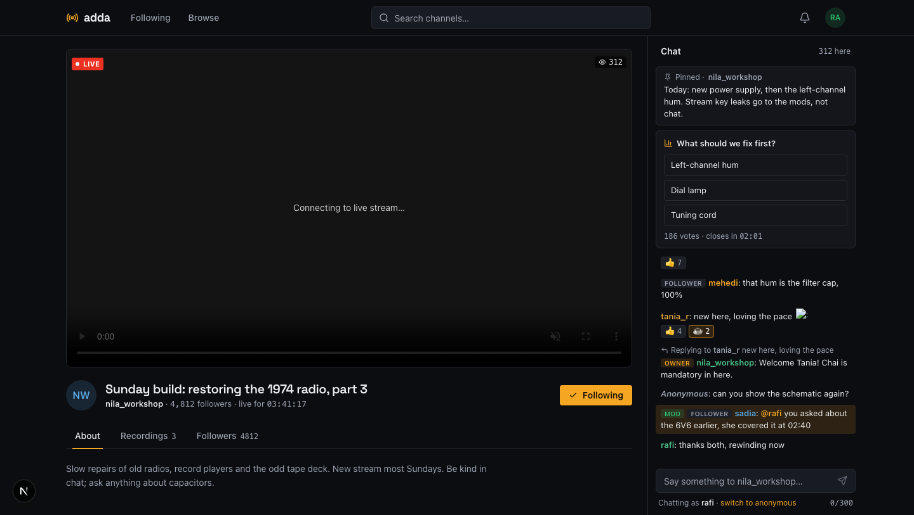
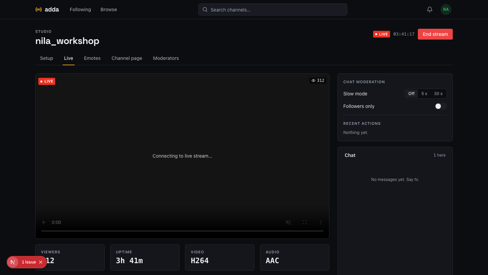
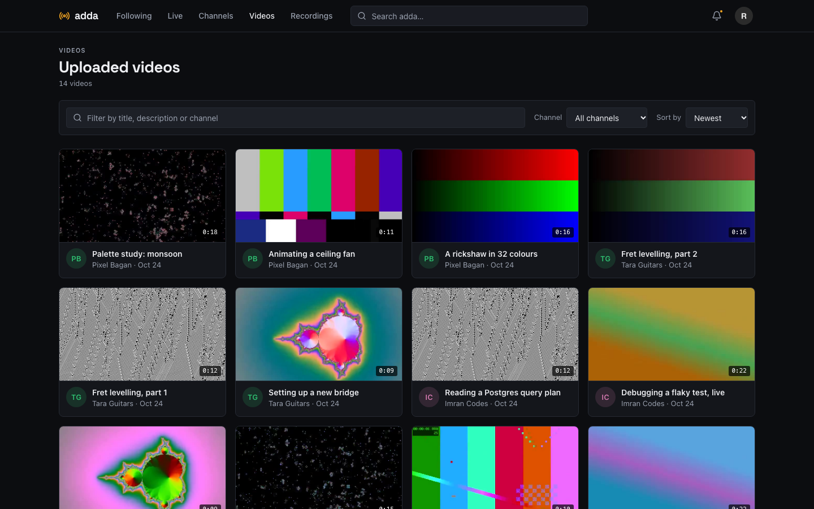
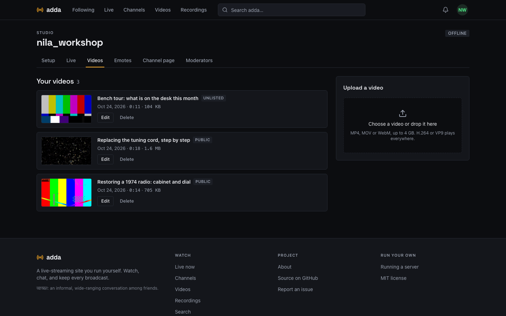

<h1 align="center">adda</h1>

<p align="center">
  <strong>A self-hosted live-streaming platform for the browser.</strong><br>
  Stream from OBS. Viewers watch and chat in realtime. Every broadcast is recorded.<br>
  No accounts on someone else's servers, no per-minute fees, no cloud.
</p>

<p align="center">
  <a href="https://github.com/shahadathhs/adda/actions/workflows/ci.yml"></a>
  <a href="LICENSE"></a>
  <a href="https://github.com/shahadathhs/adda/issues"></a>
  <a href="CONTRIBUTING.md"></a>
</p>

<p align="center">
  <a href="https://getadda.vercel.app">Website</a> ·
  <a href="https://getadda.vercel.app/docs/quickstart">Quickstart</a> ·
  <a href="https://getadda.vercel.app/docs">Documentation</a> ·
  <a href="https://getadda.vercel.app/blog">Blog</a> ·
  <a href="https://github.com/shahadathhs/adda/issues">Issues</a>
</p>

<p align="center">
  
</p>

> **adda** (আড্ডা) is Bengali for an informal, wide-ranging conversation among friends.

## Contents

- [Features](#features)
- [Screenshots](#screenshots)
- [Quick start](#quick-start)
- [How it works](#how-it-works)
- [Tech stack](#tech-stack)
- [Project layout](#project-layout)
- [Development](#development)
- [Configuration](#configuration)
- [Testing and quality](#testing-and-quality)
- [Status and roadmap](#status-and-roadmap)
- [Documentation](#documentation)
- [Contributing](#contributing)
- [Security](#security)
- [License](#license)

## Features

**Watch and chat**

- **Live streaming:** publish from OBS over RTMP; viewers watch over HLS in the browser,
  with a viewer count and automatic reconnect.
- **Realtime chat** on every channel: replies, @mentions, reactions, custom emotes, a
  pinned message and live polls.
- **Identity mode:** accounts chat under their name or as "Anonymous". The server still
  records the account, and moderators can see who is behind a message (every lookup is
  logged).
- **Guests can watch and read.** Everything interactive needs an account, so every action
  in the database belongs to someone.

**Content**

- **Recordings** of every broadcast, with timestamped comments.
- **Video uploads:** channel owners upload MP4, MOV or WebM (up to 4 GB, resumable) and
  viewers watch them on the channel, in a video directory and in search. Public, unlisted
  or private. No transcoding.
- **Channel pages** with an about text, links, a banner, announcements, badges and
  moderators.
- **Find things fast:** one search box with suggestions, plus Live, Channels, Videos and
  Recordings directories with filters, sorting and numbered pagination.

**Community**

- **Follows and a notification bell**, with optional email alerts (at most one an hour per
  channel) when a followed channel goes live.
- **Moderation:** delete, time out, ban, slow mode, followers-only, rate limits and an
  audit log.
- **Profiles:** a picture and a status line with an optional end time.

**Running it**

- **One command to install**, automatic HTTPS, and every secret generated for you.
- **Operable:** `/health`, `/ready`, Prometheus `/metrics`, JSON logs, and backup and
  restore scripts.

## Screenshots

| Studio                                                        | Video directory                                                 |
| ------------------------------------------------------------- | --------------------------------------------------------------- |
|    |           |
| **Uploading videos**                                          | **Channel profile**                                             |
|  |  |

All 28 concept screens the app is built against are in [docs/design](docs/design/SCREENS.md).

## Quick start

### Install on a server

You need a Linux server with a domain pointing at it, and ports 80, 443 and 1935 open.
Run this as root:

```bash
curl -fsSL https://raw.githubusercontent.com/shahadathhs/adda/main/scripts/install.sh | sh
```

It asks for your domain and admin email, installs Docker if needed, generates every
secret, starts the stack with automatic HTTPS, and prints the admin password once. Then:

1. Sign in with the admin email and create your channel.
2. Open **Studio → Setup**, and copy the server URL and stream key into OBS
   (Settings → Stream → Custom).
3. Press **Start Streaming**.

Email (password-reset links, optional live alerts) is off until you add the `SMTP_*` values
to `/opt/adda/.env`. The full guide is at [getadda.vercel.app/docs/quickstart](https://getadda.vercel.app/docs/quickstart).

### Try it locally

You need Docker, [uv](https://docs.astral.sh/uv/) and [pnpm](https://pnpm.io/) (Node 22).

```bash
git clone https://github.com/shahadathhs/adda.git
cd adda
make setup      # .env files, dependencies, Postgres + Redis + mediamtx in Docker, migrations
make dev        # backend on :7001 and web on :5173, with hot reload
```

Or run everything in containers with `make up`. Then publish a test pattern so the live
screens have something to show:

```bash
scripts/test-stream.sh <channel-slug>
```

## How it works

```
OBS ──RTMP──▶ mediamtx ──auth webhook──▶ backend (FastAPI) ◀──▶ Postgres
                 │                            │   ▲
                 └──HLS──▶ viewers' browsers  │   └── Redis (pub/sub, presence,
                                              │        rate limits, poll tallies)
                     web (Next.js) ◀──REST + WebSocket──┘
                     Caddy: HTTPS in front of everything
```

- **Streaming:** the encoder publishes RTMP with the channel's key. mediamtx asks the
  backend whether the key is right (one webhook is the whole security model), writes HLS for
  viewers and MP4 recordings to disk.
- **Chat:** one WebSocket. Messages are saved to Postgres first, then fanned out through
  Redis to every backend instance.
- **Videos:** uploaded in 8 MB parts at explicit offsets so a dropped connection resumes;
  inspected with ffprobe and prepared for direct play (no re-encoding).

[docs/ARCHITECTURE.md](docs/ARCHITECTURE.md) has the details.

## Tech stack

| Layer     | Technology                                                                    |
| --------- | ----------------------------------------------------------------------------- |
| Backend   | Python, FastAPI, async SQLAlchemy, Alembic, `uv`                              |
| Web       | Next.js (App Router), React, TanStack Query, Tailwind CSS, hls.js             |
| Data      | PostgreSQL, Redis                                                             |
| Streaming | [mediamtx](https://github.com/bluenviron/mediamtx) (RTMP in, HLS out), ffmpeg |
| Delivery  | Docker Compose, Caddy (automatic HTTPS)                                       |
| Site      | Static Next.js, deployed on Vercel                                            |
| Tests     | pytest, Playwright                                                            |

## Project layout

```
adda/
├── backend/   FastAPI API and WebSocket gateway (modules/<feature>/, alembic/)
├── web/       Viewer and studio app (Next.js)
├── site/      Marketing and docs site (static Next.js)
├── infra/     mediamtx and Caddy configuration
├── scripts/   install, backup, restore, test stream, design renders
├── e2e/       Playwright tests against the running stack
└── docs/      Scope, flows, architecture, operations, design system
```

## Development

```bash
make setup           # first time
make dev             # backend :7001 and web :5173 with hot reload
make site-dev        # the marketing and docs site on :4321
```

| Service                            | Port                      |
| ---------------------------------- | ------------------------- |
| Web                                | 5173                      |
| Backend                            | 7001                      |
| Postgres / Redis                   | 5432 / 6379               |
| mediamtx RTMP / HLS / WebRTC / API | 1935 / 8888 / 8889 / 9997 |

Start with [AGENTS.md](AGENTS.md) for the layout and conventions, and keep the WebSocket
contract (`backend/modules/realtime/protocol.py` and `web/src/lib/types/realtime.ts`) in
sync. UI work follows [docs/DESIGN.md](docs/DESIGN.md).

## Configuration

Configuration is environment-driven; `.env.example` lists every variable. The ones people
change:

| Variable               | Meaning                                                              |
| ---------------------- | -------------------------------------------------------------------- |
| `ADDA_DOMAIN`          | The public domain                                                    |
| `SMTP_*`               | Email for reset links and opt-in live alerts (empty means email off) |
| `LOG_FORMAT`           | `json` (default in compose) or `text`                                |
| `SUPERADMIN_*`         | The seeded admin account                                             |
| `NEXT_PUBLIC_SITE_URL` | Optional: the website linked from the footer and About page          |

See [docs/OPERATIONS.md](docs/OPERATIONS.md) for metrics, backup and restore, and upgrades.

## Testing and quality

```bash
make test           # 159 backend tests against an embedded Postgres, no Docker needed
pnpm e2e            # 12 Playwright tests against the running stack (needs ffmpeg or Docker)
make lint           # ruff + oxlint + prettier
make typecheck      # pyright
pnpm typecheck      # tsc
pnpm check:design   # banned UI patterns from docs/DESIGN.md
make check          # everything, including the builds
```

CI runs all of it on every push and pull request. One more test starts two real server
processes against one Redis to prove chat fans out across instances.

## Status and roadmap

**Feature-complete for v1, not yet released.** Every flow in [docs/FLOWS.md](docs/FLOWS.md)
is built and tested.

| Flow   | What                                                                                       | Status                                      |
| ------ | ------------------------------------------------------------------------------------------ | ------------------------------------------- |
| F0     | One-command install, HTTPS, generated secrets                                              | Built; clean-server timing not yet measured |
| F1     | Register, login, rotating refresh tokens, change and reset password, profile               | Built; reset email needs SMTP               |
| F2     | Home, global search, directories with pagination, channel pages (SSR), HLS player, About   | Built                                       |
| F3, F4 | Create channel, stream key, rotate, go live, offline detection, end stream                 | Built                                       |
| F5     | Chat: history, send, delete, moderators, slow mode, followers-only, timeouts, bans, limits | Built                                       |
| F6     | Follows                                                                                    | Built                                       |
| F7     | Recordings, thumbnails, playback, download, owner delete                                   | Built; no transcoding                       |
| F8     | Admin API, health, readiness, metrics, JSON logs, backup and restore                       | Built; no admin web UI                      |
| F9–F14 | Guests, replies, mentions, reactions, pins, emotes, polls, notifications, identity mode    | Built                                       |
| F15    | Channel profile: about, links, banner, announcements, followers                            | Built                                       |
| F16    | Recording comments                                                                         | Built                                       |
| F17    | Uploaded videos: resumable upload, direct play, visibility, directory                      | Built; no transcoding                       |

**Still to do before v1.0.0:** a timed clean-server install, glass-to-glass latency and
fan-out measurements, deploying the website, and pointing the install script at `main`.

**Not in v1:** desktop or mobile apps, direct messages, several rooms per channel, a light
theme, an admin web UI (admin actions are an API), transcoding or clips, and WebRTC
playback (HLS only). [docs/SCOPE.md](docs/SCOPE.md) has the reasoning.

## Documentation

| Doc                                              | Contents                                                |
| ------------------------------------------------ | ------------------------------------------------------- |
| [docs/SCOPE.md](docs/SCOPE.md)                   | Goal, scope, non-goals, milestones                      |
| [docs/FLOWS.md](docs/FLOWS.md)                   | Acceptance criteria per flow and the screen-to-test map |
| [docs/CHAT.md](docs/CHAT.md)                     | Chat backend design: data model, wire protocol, rules   |
| [docs/ARCHITECTURE.md](docs/ARCHITECTURE.md)     | How the pieces fit                                      |
| [docs/OPERATIONS.md](docs/OPERATIONS.md)         | Install, metrics, backup and restore, upgrade           |
| [docs/DESIGN.md](docs/DESIGN.md)                 | Design system                                           |
| [docs/design/SCREENS.md](docs/design/SCREENS.md) | The concept screens                                     |
| [AGENTS.md](AGENTS.md)                           | Conventions for contributors and coding agents          |

The same material, written for people running a server, is on the
[website](https://getadda.vercel.app/docs).

## Contributing

Contributions are welcome. Read [CONTRIBUTING.md](CONTRIBUTING.md) first: it covers the
setup, the checks a pull request must pass, and the conventional-commit format that a git
hook enforces. Please follow the [Code of Conduct](CODE_OF_CONDUCT.md).

## Security

Please report vulnerabilities privately; see [SECURITY.md](SECURITY.md). Do not open a
public issue for one.

## License

[MIT](LICENSE) © shahadathhs
