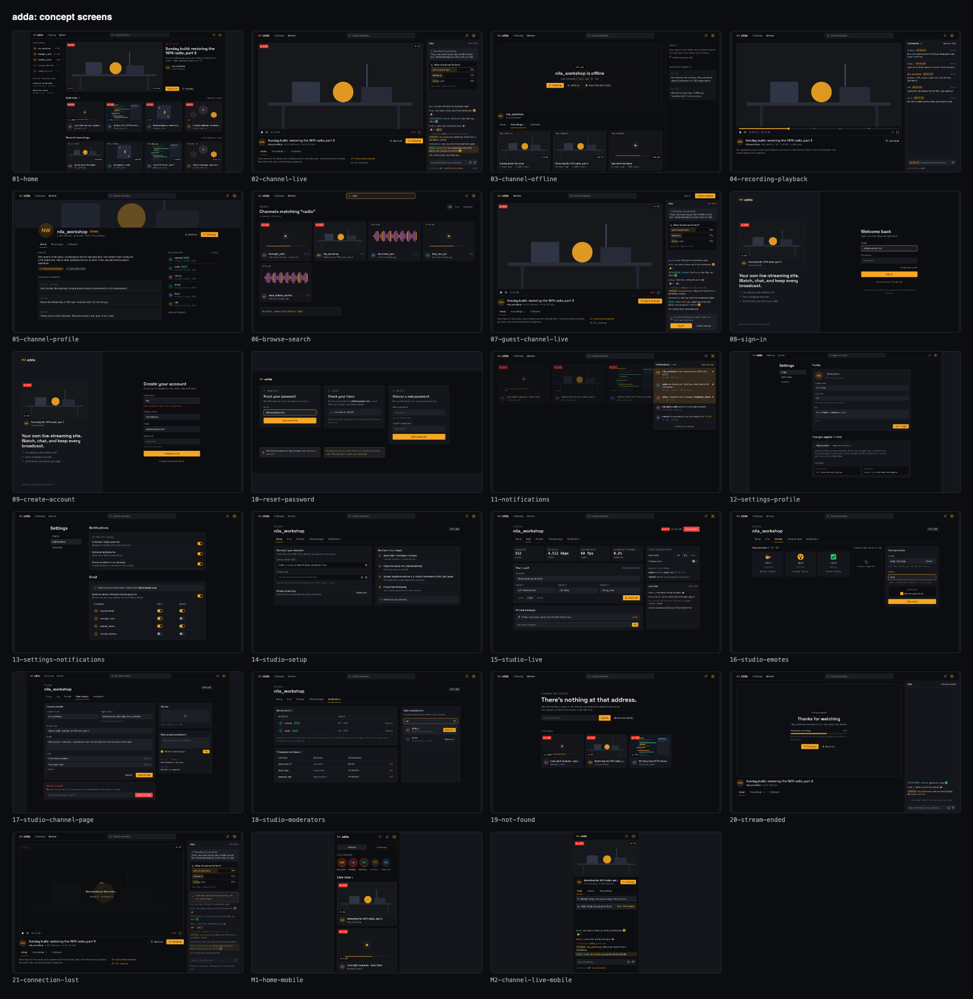

# adda

**A self-hosted live-streaming platform for the browser.** Install it on your
own server, stream from OBS, and viewers watch and chat in realtime while every
broadcast is recorded. No accounts on someone else's servers, no per-minute
fees, no cloud.

> **adda** (আড্ডা) — Bengali for an informal, wide-ranging conversation among
> friends.



> **Status: feature-complete for v1, not yet released.** Every flow below is built and
> tested. A timed clean-server install and latency numbers are still to be measured, and
> the site is not deployed yet. See [what is built, and what is not](#status).

## What you get

- **Live streaming:** publish from OBS over RTMP; viewers watch over HLS in the
  browser, with a viewer count and an automatic reconnect.
- **Realtime chat** on every channel, with replies, @mentions, reactions,
  custom emotes, a pinned message and live polls.
- **Follows and a notification bell** (optional email alerts when a followed
  channel goes live).
- **Recordings** of every broadcast, with timestamped comments.
- **Channel pages** with about text, links, announcements, badges and
  moderators.
- **Moderation:** delete, time out, ban, slow mode, followers-only.
- **Identity mode:** accounts chat under their name or as "Anonymous". The
  server still records the account, and moderators can see who is behind a
  message.
- **One command to install**, automatic HTTPS, and every secret generated for
  you.

Guests can watch and read chat. Everything interactive needs an account, so
every action in the database belongs to someone.

## How it works

```
OBS ──RTMP──▶ mediamtx ──auth webhook──▶ backend (FastAPI) ◀──▶ Postgres
                 │                            │   ▲
                 └──HLS──▶ viewers' browsers  │   └── Redis (pub/sub, presence,
                                              │        rate limits, poll tallies)
                     web (Next.js) ◀──REST + WebSocket──┘
                     Caddy: HTTPS in front of everything
```

- **backend/**: FastAPI, async SQLAlchemy, Alembic. Features live in
  `modules/<feature>/` with a thin router and a `service/` package.
- **web/**: Next.js App Router app for viewers and streamers (SSR for browse and
  channel pages).
- **infra/**: mediamtx and Caddy configuration.
- **site/**: the marketing and documentation site (deployed separately).

## Status

Every flow, with its acceptance criteria and the screen it belongs to, is in
[docs/FLOWS.md](docs/FLOWS.md).

| Flow   | What                                                                                       | Status                                      |
| ------ | ------------------------------------------------------------------------------------------ | ------------------------------------------- |
| F0     | One-command install, HTTPS, generated secrets                                              | Built; clean-server timing not yet measured |
| F1     | Register, login, rotating refresh tokens, change and reset password                        | Built; reset email needs SMTP               |
| F2     | Home, search, channel pages (SSR), HLS player, viewer counts                               | Built                                       |
| F3, F4 | Create channel, stream key, rotate, go live, offline detection, end stream                 | Built                                       |
| F5     | Chat: history, send, delete, moderators, slow mode, followers-only, timeouts, bans, limits | Built                                       |
| F6     | Follows                                                                                    | Built                                       |
| F7     | Recordings, thumbnails, playback, download, owner delete                                   | Built; no transcoding                       |
| F8     | Admin API, health, readiness, metrics, JSON logs, backup and restore                       | Built; no admin web UI                      |
| F9–F14 | Guests, replies, mentions, reactions, pins, emotes, polls, notifications, identity mode    | Built                                       |
| F15    | Channel profile: about, links, banner, announcements, followers                            | Built                                       |
| F16    | Recording comments                                                                         | Built                                       |

Tests: `make test` runs 143 backend tests (accounts and tokens, channels, streams, chat
rules, polls, emotes, notifications, identity, the channel page, recording comments,
migrations, operability) against an embedded Postgres, and one more test starts two real
server processes against one Redis. `pnpm e2e` runs 5 Playwright tests against the real
stack with an ffmpeg test-pattern publisher. CI runs all of it
([docs/SCOPE.md](docs/SCOPE.md) has the milestones).

## Not in v1

No desktop or mobile apps, no direct messages, no communities with multiple
rooms, no light theme, no admin web UI (admin actions are an API), no
transcoding or clips, and no WebRTC playback (HLS only). See
[docs/SCOPE.md](docs/SCOPE.md) for the reasoning.

## Install (on a server)

You need a Linux server with a domain pointing at it and ports 80, 443 and 1935
open. Run this as root:

```bash
curl -fsSL https://raw.githubusercontent.com/shahadathhs/adda/dev/scripts/install.sh | sh
```

It asks for your domain and admin email, installs Docker if needed, generates
every secret, starts the stack with automatic HTTPS, and prints the admin
password once. Then:

1. Sign in with the admin email, and create your channel.
2. Open **Studio → Setup**, copy the server URL and stream key into OBS
   (Settings → Stream → Custom).
3. Press **Start Streaming**.

Email (password reset links, optional live alerts) is off until you add the
`SMTP_*` values to `/opt/adda/.env`.

## Develop locally

Needs Docker, [uv](https://docs.astral.sh/uv/) and
[pnpm](https://pnpm.io/) (Node 22).

```bash
make setup          # .env files, dependencies, Postgres + Redis + mediamtx in Docker, migrations
make dev            # backend on :7001 and web on :5173, with hot reload
```

Or run everything in containers with `make up`.

| Service                            | Port                      |
| ---------------------------------- | ------------------------- |
| Web                                | 5173                      |
| Backend                            | 7001                      |
| Postgres / Redis                   | 5432 / 6379               |
| mediamtx RTMP / HLS / WebRTC / API | 1935 / 8888 / 8889 / 9997 |

Quality gates (all run in CI):

```bash
make lint           # ruff + oxlint + prettier
make typecheck      # pyright
pnpm typecheck      # tsc
pnpm check:design   # banned UI patterns from DESIGN.md
make test           # backend tests, no Docker needed
pnpm e2e            # Playwright against the running stack (needs ffmpeg or Docker)
make check          # everything, including the builds
```

`scripts/test-stream.sh <channel-slug>` publishes a test pattern to a channel so the live
screens have something to show.

## Design

The visual system is in [DESIGN.md](docs/DESIGN.md): dark ink surfaces, one marigold
accent, a separate red that is only ever used for live states, mono numerals,
and a strict radius and motion scale. Concept renders of all 23 screens are in
[docs/design/](docs/design/SCREENS.md); regenerate them with
`node scripts/render-design.mjs`.

## Documentation

| Doc                                              | Contents                                                |
| ------------------------------------------------ | ------------------------------------------------------- |
| [docs/SCOPE.md](docs/SCOPE.md)                   | Goal, scope, non-goals, milestones                      |
| [docs/FLOWS.md](docs/FLOWS.md)                   | Acceptance criteria per flow and the screen-to-test map |
| [docs/CHAT.md](docs/CHAT.md)                     | Chat backend design: data model, wire protocol, rules   |
| [docs/design/SCREENS.md](docs/design/SCREENS.md) | The concept screens                                     |
| [docs/ARCHITECTURE.md](docs/ARCHITECTURE.md)     | How the pieces fit                                      |
| [docs/OPERATIONS.md](docs/OPERATIONS.md)         | Install, metrics, backup and restore, upgrade           |
| [DESIGN.md](docs/DESIGN.md)                      | Design system                                           |
| [AGENTS.md](AGENTS.md)                           | Conventions for contributors and coding agents          |

## Contributing

See [CONTRIBUTING.md](CONTRIBUTING.md). Conventional commits are enforced by a git hook. Start with
[AGENTS.md](AGENTS.md) for the layout and rules, and keep the WebSocket
contract (`backend/modules/realtime/protocol.py` and
`web/src/lib/types/realtime.ts`) in sync.

## License

[MIT](LICENSE).
